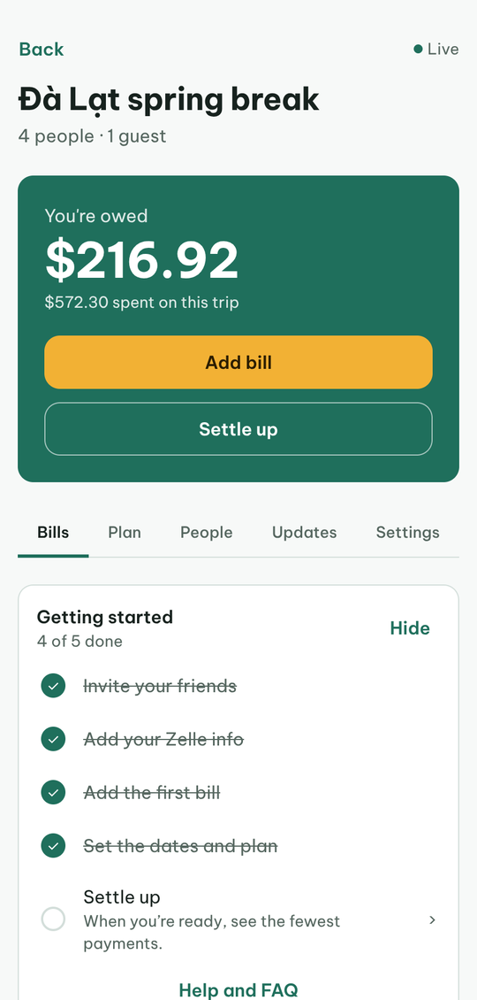
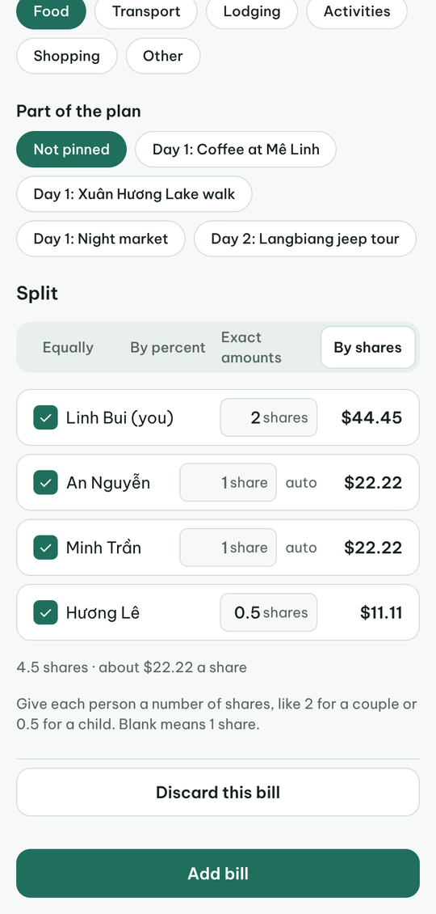
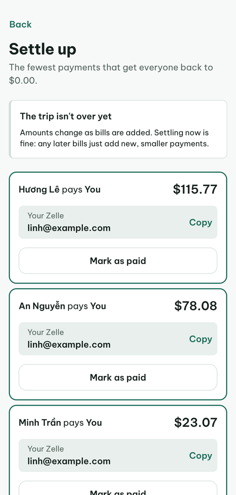
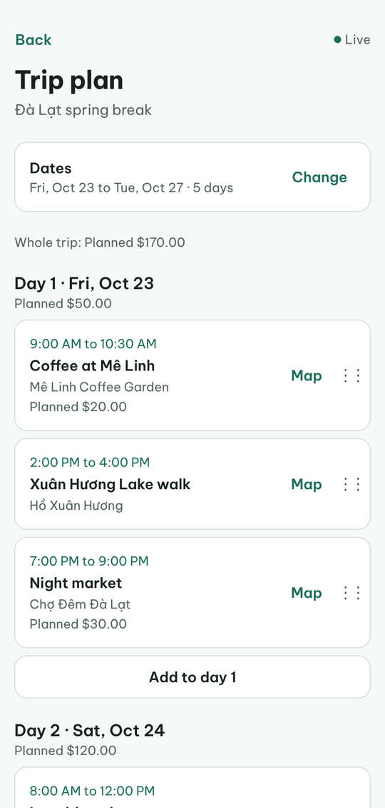
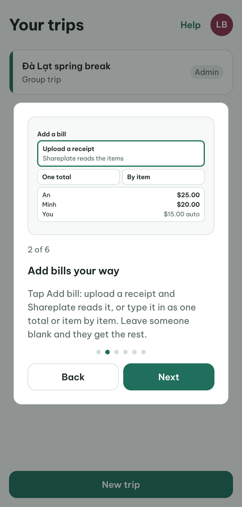
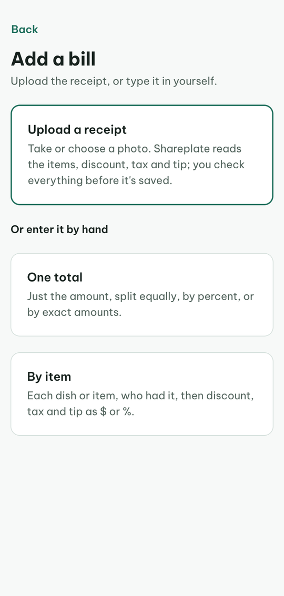
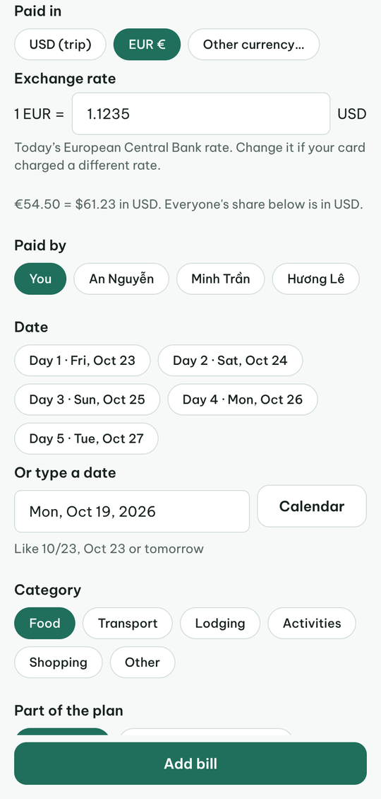
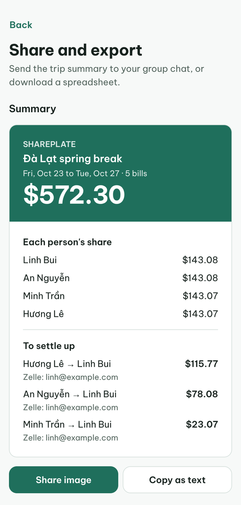

<p align="center">
  
</p>

<h1 align="center">Shareplate</h1>

<p align="center">
  <strong>Split trip bills fairly, down to the last cent, and plan the trip together.</strong><br />
  Scan a receipt, say who had what, and see who owes whom in as few payments as possible.
</p>

<p align="center">
  <a href="https://shareplate-trips.vercel.app"><strong>Try it live → shareplate-trips.vercel.app</strong></a>
</p>

<p align="center">
  
  &nbsp;
  
  &nbsp;
  
  &nbsp;
  
</p>

---

## Why I built it

On group trips, someone always ends up with a spreadsheet, a pile of receipts and
a group chat full of "who paid for dinner?". Existing apps often round money
loosely, limit what's free, or don't handle the real mess: one person
had two drinks, the tip is split evenly but tax isn't, a bill was paid in euros,
someone left the trip halfway. Shareplate handles those cases and keeps every
balance exact to the cent.

## What it does

| | |
|---|---|
| **Receipt scanner** | Take a photo and the items, prices, tax and tip are read automatically. Check them in a step-by-step flow with the photo always beside you, then tap who had each item. |
| **Any way to split** | Equally, by percent, by exact amounts, by shares (2 for a couple, 0.5 for a child) or item by item. Leave someone blank and they get what's left. |
| **Any currency** | Pay in yen, francs or dong. The day's exchange rate (European Central Bank) fills in, and everyone's share is converted to the trip's currency. |
| **Fewest payments** | Settle up works out the smallest set of payments that clears every balance, and shows where to send money. |
| **Live for everyone** | Friends join with an invite link and see bills, balances and changes in real time. Guests without an account are supported too. |
| **Trip plan and budget** | Day-by-day activities with times and places (free OpenStreetMap search), a trip budget and spending by day. |
| **Share and export** | A summary card for the group chat, a personal message for each person, and an Excel or CSV export. |
| **Safe changes** | Before deleting or editing a bill, you see whose balance changes. People who leave are kept at exactly $0.00. |
| **Built-in help** | A picture tour for new users, a Getting started checklist, guides, an FAQ, What's new and a feedback form. |

<p align="center">
  
  &nbsp;
  
  &nbsp;
  
  &nbsp;
  
</p>

## Engineering highlights

- **Exact money.** Every amount is an integer number of cents, never a float.
  Splits use the largest-remainder method, so shares always add up to the bill
  total and nobody is off by more than one cent. Currency conversion uses
  BigInt arithmetic. The rules are written up in
  [docs/money-engine.md](docs/money-engine.md).
- **The database enforces the rules, not just the app.** Postgres row-level
  security decides who sees what; transaction-level constraint triggers check
  that every bill's shares add up, that percentages total 100%, and that people
  who left the trip stay at $0.00.
- **Serverless functions** for reading receipts (Gemini vision), exchange rates
  and place search, with sign-in checks and no secrets in the app.
- **Tested end to end.** About 290 automated tests, including property-based
  tests of the money engine and the full database schema running in an
  in-memory Postgres. Every feature is also walked through in a real browser before release.
- **Shipped like a product.** Every change goes through a pull request with
  CI (typecheck, lint, tests), a preview deploy, and automatic database
  migrations on merge. 67 written design decisions are in
  [docs/decisions.md](docs/decisions.md).
- **Accessible.** Screen-reader labels, keyboard support and light and dark mode
  throughout.

## Tech stack

- **App:** React Native with [Expo](https://expo.dev) and Expo Router, TypeScript, TanStack Query. The web today, with iPhone and Android from the same code.
- **Backend:** [Supabase](https://supabase.com): Postgres, Google sign-in, real-time updates, file storage and Edge Functions (Deno).
- **Hosting and CI:** Vercel and GitHub Actions.
- **Tests:** Vitest, fast-check (property-based tests) and PGlite (Postgres in memory).

## Project layout

```
src/app/          screens (every file is a route)
src/money/        the money engine: pure TypeScript, no UI, fully tested
src/lib/          queries, sign-in, help content, export
src/components/   shared building blocks
supabase/         migrations, schema tests and Edge Functions
docs/             roadmap, design decisions, money rules
```

## Status

The website is live. An iPhone app is next on the
[roadmap](docs/roadmap.md).

## License

Copyright © 2026 Linh Bui. **All rights reserved.** The code is public so it can
be reviewed. It is not open source, and it may not be copied, reused or hosted
without written permission. See [LICENSE](LICENSE).

## Author

Designed and built by **Linh Bui** ([@linhkhanh-a](https://github.com/linhkhanh-a)).
